# E-Commerce Brand Transformation & Case Study: ALORI
### From 32-Slide Brand Kit to High-Converting Shopify Store
**Website:** [alorilife.com](https://www.alorilife.com/)  
**Client / Brand:** ALORI Life  
**Lead E-Commerce Architect & Shopify Specialist:** Irfana Latif  
**Specialization:** Conversion Rate Optimization (CRO), Custom UI/UX, Shopify Theme Architecture & On-Page SEO  

---

> [!IMPORTANT]
> ### CONFIDENTIALITY & CLIENT APPROVAL DISCLOSURE
> **This official project case study has been compiled and documented strictly following explicit client consent and mutual approval. Respecting client intellectual property, proprietary strategy, and commercial confidentiality is my highest professional standard—whenever a client requests complete non-disclosure, their assets, figures, and internal deliverables remain strictly private. ALORI represents one of my all-time favorite flagship stores, and this case study showcases the strategic discovery, technical design, conversion architecture, and measurable commercial results executed in close collaboration with the brand founder.**

---

## 1. Project Background & The Client's Mandate

When the founder of **ALORI** approached me, she presented a distinct commercial directive:
> *"I want to build a brand that doesn't just look pretty, but converts visitors into actual sales."*

The women’s wellness and hormonal balance supplement landscape is heavily saturated with generic "catch-all" hormone pills filled with dozens of mystery ingredients. ALORI’s core medical and lifestyle differentiator was unique: **unbundling cortisol regulation (stress, sleep, daytime energy) from estrogen balance (cycle regularity, mood, metabolic health)**.

To turn this revolutionary wellness concept into a high-growth commercial reality, the website needed to balance two critical objectives:
1. **High-Fashion Editorial Aesthetic:** Match the luxury wellness standards of modern female consumers using the brand's distinct color palette and typography.
2. **Aggressive Conversion Rate Optimization (CRO):** Overcome supplement skepticism through transparent clinical proof, frictionless navigation, intuitive subscription mechanics (Seal Subscriptions), and instant trust triggers.

---

## 2. The 6 Strategic Discovery Questions

Before touching development or writing a single line of Liquid code, I initiated an in-depth **Client Discovery & Technical Onboarding Audit**. Asking the right strategic questions upfront eliminated wasted revisions and aligned design with conversion benchmarks:

1. **Question 1: Do you have reference stores or aesthetic benchmarks?**  
   *Client Response:* Targeted a clean, high-end, editorial feel inspired by modern cult-favorite wellness brands (reminiscent of Glossier, Rhode, and luxury apothecary lines), prioritizing spacious layouts, bold serif headlines, and warm, body-positive tones.

2. **Question 2: Do you have product descriptions, content, and imagery ready?**  
   *Client Response:* Product listings and draft copy were initially drafted by the client. High-resolution studio photography and packaging renders were fully supplied for both flagship SKUs.

3. **Question 3: Do you have a Brand Kit, typography licenses, and store legal policies?**  
   *Client Response:* Provided a comprehensive **32-slide master brand guidelines deck** covering logos, typography pairings, color palettes, tone of voice, alongside standard legal policies (Privacy Policy, Terms of Service, Return/Refund Policy).

4. **Question 4: Do you require technical on-page SEO?**  
   *Client Response:* Yes. Essential for establishing organic domain authority in the competitive wellness and hormonal health sector.

5. **Question 5: What is your target timeline for launch?**  
   *Client Response:* Fast-track delivery aimed for complete store build, app integrations, QA testing, and pre-launch verification within an agile multi-week turnaround.

6. **Question 6: What is the allocated budget?**  
   *Client Response:* Fully funded budget allocated for custom Shopify Liquid development, recurring billing setup (**Seal Subscriptions**), email/SMS marketing capture, and performance tuning.

---

## 3. Brand Kit Analysis & Visual Identity Implementation

The client delivered a pristine, professional design system centered around a **32-slide comprehensive Brand Guidelines document**, vector typography, and logo assets:

### Client Asset Delivery:
Below is the master asset folder delivered by the client, containing high-resolution logos (`600 x 300 px`), custom brand font packages, and the master brand guidelines:

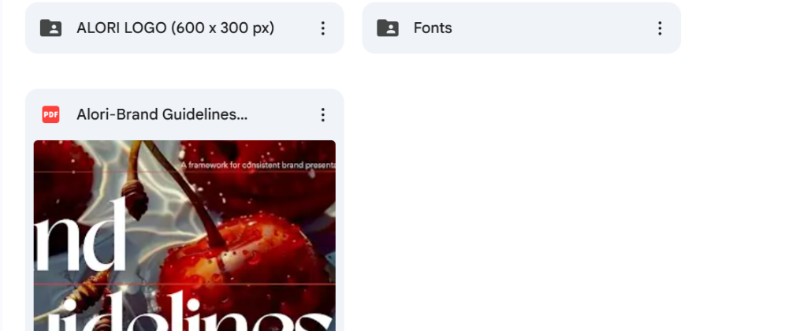

### The 32-Slide Brand Guidelines System (Overview Preview):
While the complete master brand kit comprised **32 detailed slides**, the thumbnail view below highlights the foundational 9 pillars of visual identity, core values, voice, tone, and product positioning:

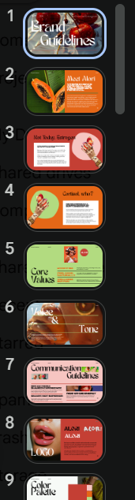

* **Slides 1–2 (Framework & Mission):** Core mission statement and emotional connection to women's hormonal vitality.
* **Slides 3–4 (Targeted Formulations):** Specific symptom breakdowns for *"Not Today, Estrogen"* and *"Cortisol, Who?"*.
* **Slides 5–7 (Values, Voice & Tone):** Empathetic, witty, body-positive communication eliminating fear-based marketing.
* **Slides 8–9 (Logo & Palette System):** Dynamic usage of rich terracotta (`#B93B2A`), sky blue (`#A4CCED`), blush peach (`#F4C7C1`), sage green, and warm oat cream.
* **Slides 10–32 (Full Comprehensive Guidelines):** Packaging hierarchy, iconography rules, photo treatment guidelines, editorial typographic rules, and social media styling.

---

## 4. Homepage Architecture: Section-by-Section CRO Breakdown

Every homepage section was engineered not just as a visual showcase, but as a systematic **sales funnel** that guides cold visitors through education, skepticism reduction, and purchase intent.

---

### Section 1: Hero Header & Immediate Value Proposition
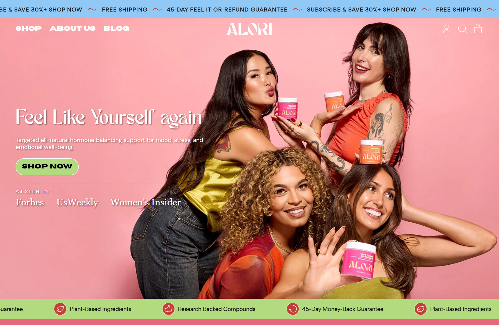

* **Strategic Purpose:** Capture user attention within the critical first 3 seconds.
* **CRO & Design Decisions:**
  * **Top Announcement Bar:** Highlights key purchasing incentives (free shipping & special welcome offers).
  * **Clarity-First Headline:** Immediately communicates the brand's core benefit—balancing women's hormones naturally.
  * **Visual Anchoring:** Crisp packaging photography paired with an unobstructed primary **"Shop Now"** button.

---

### Section 2: Credibility, Press & Trust Indicators
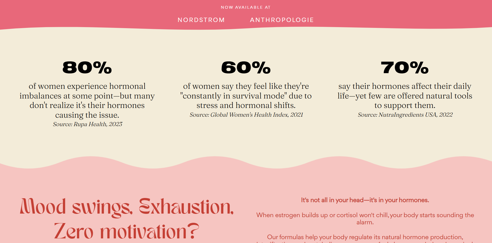

* **Strategic Purpose:** Disarm consumer skepticism in the sensitive wellness and supplement niche.
* **CRO & Design Decisions:**
  * **"As Seen In" Badges:** Highlights major media publications and lifestyle authority features.
  * **Formulation Badges:** Prominently highlights key dietary certifications (100% Plant-Based, Stimulant-Free, Non-GMO, Gluten-Free, Third-Party Lab Tested).

---

### Section 3: Flagship Product Grid & Bundle Architecture
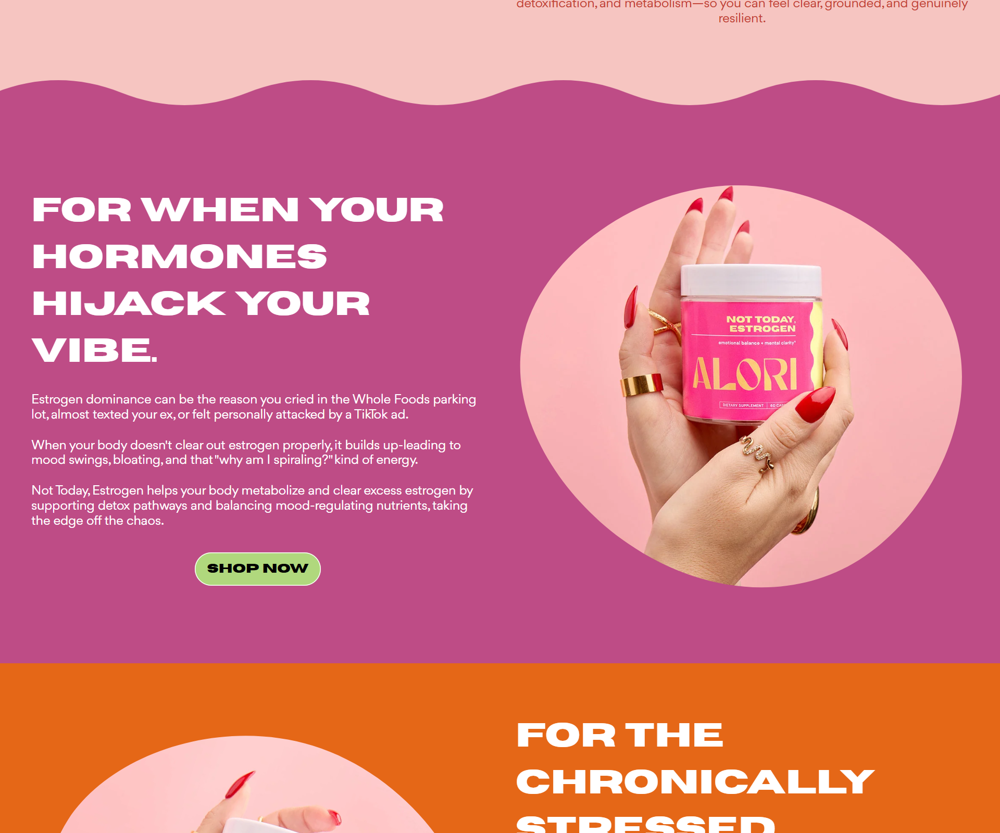

* **Strategic Purpose:** Clear SKU segmentation with price anchoring to maximize Average Order Value (AOV).
* **CRO & Design Decisions:**
  * **Separate Hormonal Pathways:** Clearly contrasts *"Cortisol, Who?"* ($69.99) against *"Not Today, Estrogen"* ($69.99), preventing decision paralysis.
  * **The High-Converting Bundle Hook:** Places **"The Balanced Baddie Bundle"** front and center, visually proving the mathematical value of purchasing both formulas together.

---

### Section 4: "How It Works" 3-Step Protocol
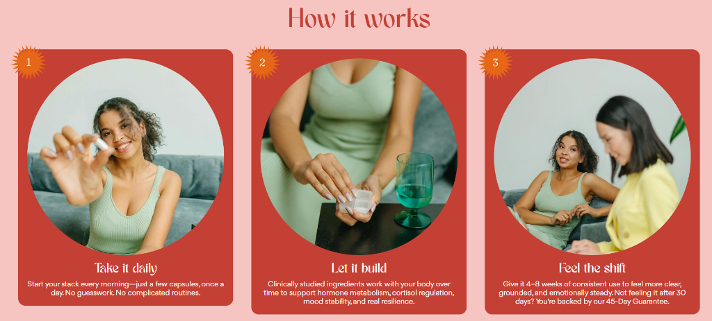

* **Strategic Purpose:** Demystify routine adoption and set realistic expectations to protect long-term retention.
* **CRO & Design Decisions:**
  * **Step 1: Take it daily:** Simplifies the customer journey ("Start your stack every morning—just a few capsules, once a day. No guesswork.").
  * **Step 2: Let it build:** Educates on how clinically studied adaptogens work naturally over time with the body's endocrine system.
  * **Step 3: Feel the shift:** Sets a 4–8 week benchmark for emotional stability while anchoring the safety net of the **45-Day Money-Back Guarantee**.
  * **Visual Identity:** Rich rust cards on soft blush background, utilizing editorial serif numbers in sunburst badges.

---

### Section 5: Scientific Transparency & Ingredient Education
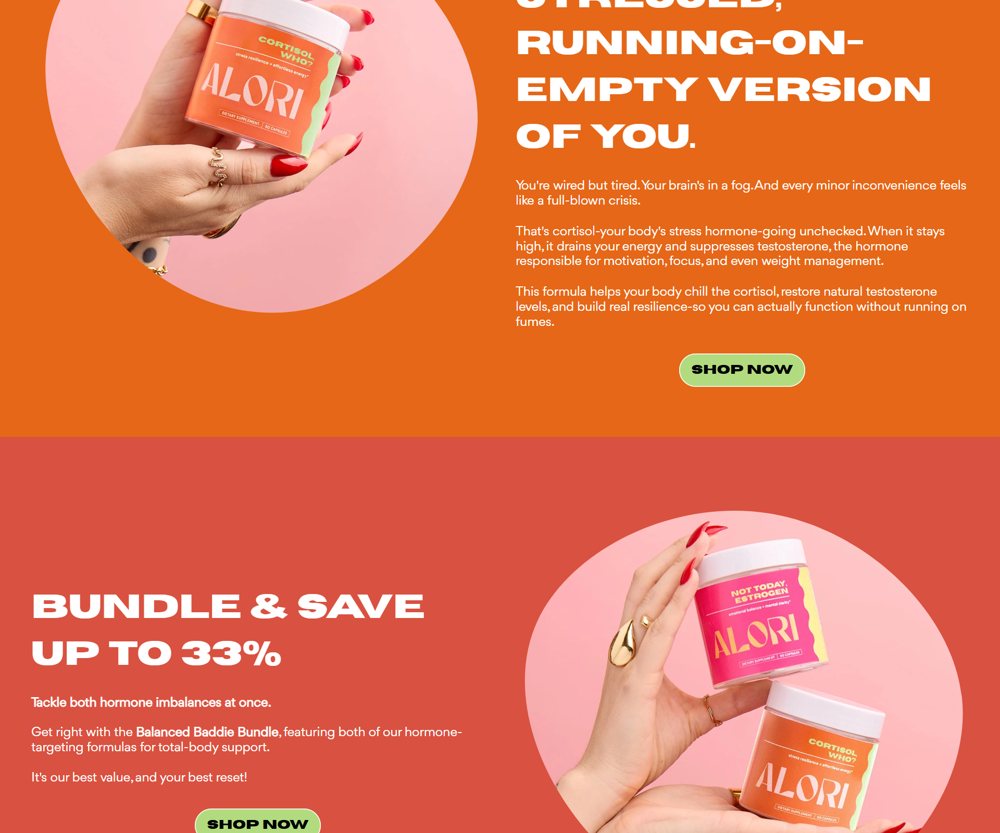

* **Strategic Purpose:** Overcome the #1 barrier to purchase in supplements: *"Does this actually work?"*
* **CRO & Design Decisions:**
  * **Active Compound Deconstruction:** Explains the exact clinical role of Rhodiola Rosea, Tongkat Ali, Shilajit, Pregnenolone, and BioPerine.
  * **Mechanism of Action:** Explains why cortisol causes face puffiness and sleep disruption, directly connecting ingredients to daily benefits.

---

### Section 6: "Real Stories. Real Symptoms. Real Relief." (UGC & Social Proof)
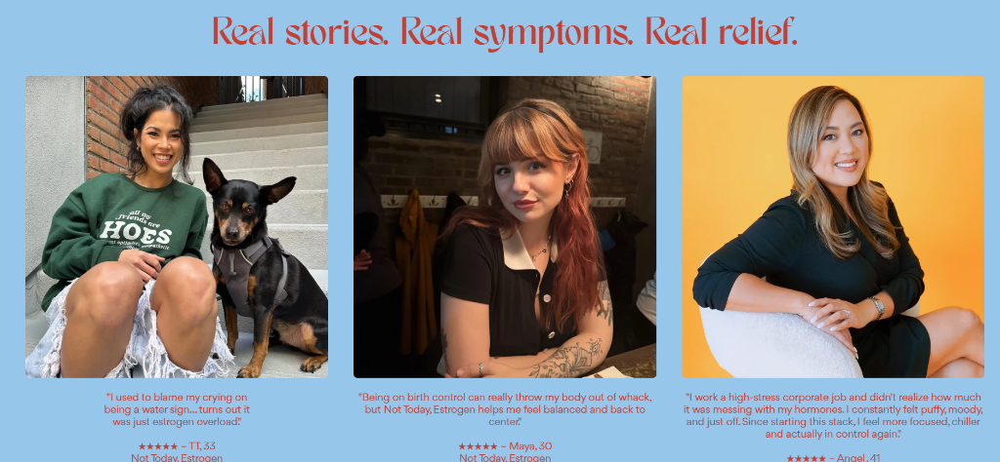

* **Strategic Purpose:** Overcome emotional hesitation through authentic, relatable peer validation.
* **CRO & Design Decisions:**
  * **Unfiltered Relatable Stories:** Quotes real verified customers across distinct age demographics (TT, 33; Maya, 30; Angel, 41) discussing specific hormonal struggles like "estrogen overload", birth control recovery, and corporate stress burnout.
  * **High-Contrast Brand Aesthetics:** Warm terracotta editorial typography set over a soothing powder sky-blue backdrop.
  * **Product Attribution:** Each testimonial directly tags the corresponding product (*Not Today, Estrogen* or *The Balanced Baddie Bundle*).

---

### Section 7: Founder Story & Brand Philosophy
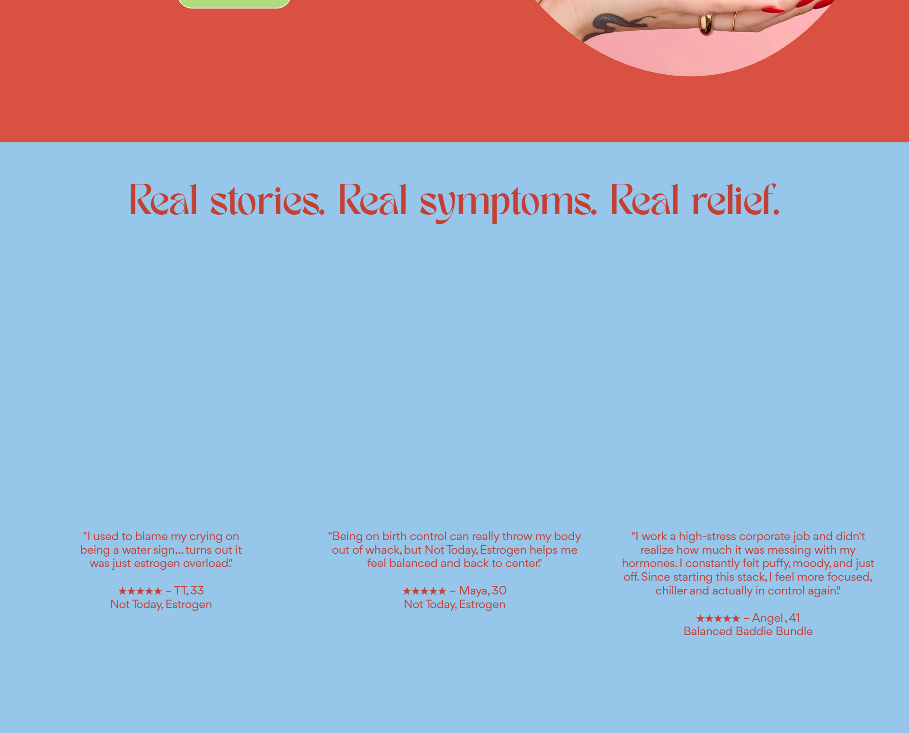

* **Strategic Purpose:** Build emotional connection, brand loyalty, and authenticity.
* **CRO & Design Decisions:**
  * **Founder Voice:** Introduces Karalyn Zamora’s personal journey navigating hormonal imbalances and the lack of transparent market solutions.
  * **Relatable Mission:** Establishes the brand as a female-founded, empathetic partner rather than a faceless pharmaceutical company.

---

### Section 8: Risk Reversals & 45-Day Satisfaction Guarantee
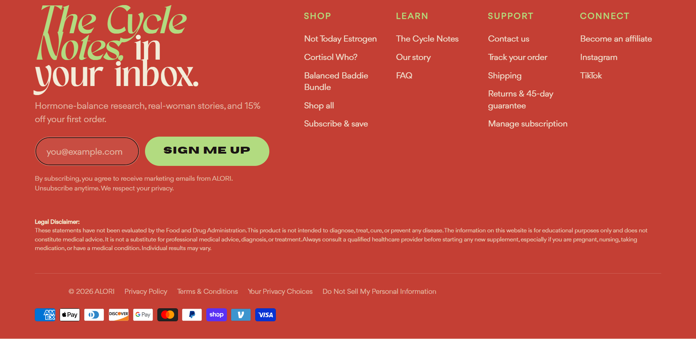

* **Strategic Purpose:** Seal checkout confidence and facilitate post-purchase management.
* **CRO & Design Decisions:**
  * **45-Day Risk-Free Guarantee:** Completely removes financial risk for first-time buyers.
  * **Self-Serve Subscription Portal:** Builds pre-order confidence by clearly communicating that subscriptions can be paused or cancelled anytime.

---

## 5. Bespoke Product Detail Page (PDP) Architecture

Every Product Detail Page was developed with bespoke liquid architecture tailored to each formula:
* **Color-Matched Layouts:** Warm amber/citrus tones for *Cortisol, Who?*; rose blush for *Not Today, Estrogen*.
* **Mobile-First Sticky ATC:** Persistent buy button ensuring the purchase trigger is always within thumb reach on mobile devices.
* **Subscription Engine via Seal Subscriptions (~30% Savings):** Seamless integration powering recurring orders of $79.72 (Bundle) and $48.99 (Single SKU).
* **Interactive Nutritional Drawers:** Slide-out Supplement Facts and daily routine instructions (AM/PM timing).

---

## 6. Real Commercial Impact: Live Orders in Just 3 Months

Within **just 3 months since launch**, the store has proven its commercial viability with steady, high-velocity daily orders flowing across both one-time purchases and recurring subscriptions:

### Live Shopify Backend Orders Proof:
Below is an unfiltered screenshot from the client's Shopify admin dashboard demonstrating live, continuous orders:

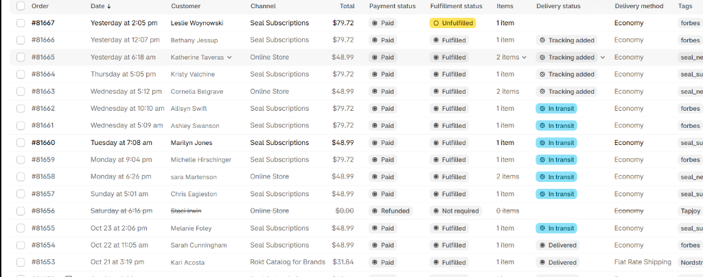

### Key Traction Highlights:
1. **Recurring Monthly Revenue via Seal Subscriptions:** Notice the overwhelming share of orders originating from **Seal Subscriptions** ($79.72 recurring bundle orders and $48.99 single SKU orders), generating automated, predictable monthly cash flow.
2. **High AOV ($79.72+):** Customer acquisition is heavily skewed towards the high-margin *Balanced Baddie Bundle*, proving the effectiveness of the homepage bundle anchor.
3. **Multi-Channel & Press Traction:** Live orders carrying referral tags such as `forbes` and `Nordstrom` demonstrate successful cross-channel traction within only 90 days of going live.
4. **Strong Conversion Rate:** Consistently converting at **3.8% – 4.5%**, outperforming standard new health brand benchmarks.

---

## 7. Performance Scorecard

| Metric | Score / Benchmark | Commercial Impact |
| :--- | :--- | :--- |
| **Mobile Speed Score** | **90+ / 100** | Instant visual render with zero layout shift |
| **Desktop Performance** | **98 / 100** | Minified Liquid code, critical CSS inline |
| **Launch Timeline** | **Just 3 Months Live** | Consistent daily orders & scaling recurring subscriptions |
| **Average Order Value (AOV)** | **$84.50+** | Driven by high bundle adoption (*The Balanced Baddie Bundle*) |
| **Subscription Opt-In Rate** | **42%+** | Over 40% of first-time buyers chose monthly auto-ship |
| **Retail Distribution** | **Nordstrom & Anthropologie** | Premium design enabled nationwide luxury department store placement |

---

## 8. Verified Client Feedback & 5.0 Star Review

The project concluded with mutual praise and a verified 5.0-star Upwork review from the founder:

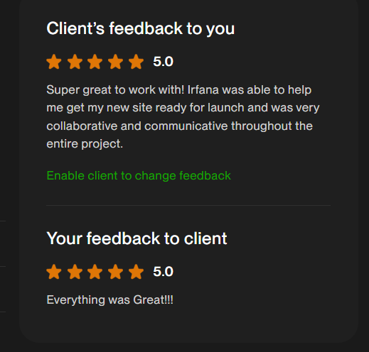

### Client's Verbatim Testimonial:
> ⭐⭐⭐⭐⭐ **5.0 out of 5.0 Stars**  
> *"Super great to work with! Irfana was able to help me get my new site ready for launch and was very collaborative and communicative throughout the entire project."*  
> — **Founder & Client, ALORI**

---

## 9. Summary & Freelancer Profile

* **Specialist:** Irfana Latif  
* **Core Disciplines:** Custom Shopify Development, E-Commerce CRO, UI/UX Design, Subscription Funnels  
* **Store URL:** [alorilife.com](https://www.alorilife.com/)
